## Current guidance and scope

**Updated 23 October 2026:** This walkthrough documents the 2020 portal and module 2.0.3. Its screenshots and role-assignment sequence are historical, not a current end-to-end deployment runbook. For new deployments, follow Microsoft’s [app-only authentication procedure](https://learn.microsoft.com/en-us/powershell/exchange/app-only-auth-powershell-v2), including current module prerequisites and supported commands.
{: .notice--warning}

Certificate authentication remains useful for unattended automation. Separate authentication from authorisation: registering a certificate proves the application’s identity, while API consent and assigned roles govern what it can do. Protect the private key and plan certificate renewal before expiry.

Before adapting the historical steps:

- Use a supported ExchangeOnlineManagement module and PowerShell combination from Microsoft’s prerequisites.
- Register the application in Microsoft Entra ID, upload only the public certificate, and retain the private key securely on the execution host or in an appropriate key store.
- Configure `Exchange.ManageAsApp` and admin consent as documented, then assign only the required management roles. The current procedure supports custom role groups with service principals for command restrictions and recipient write scopes; a broad Exchange Administrator assignment is not the default choice for every job.
- Use a CSP certificate for this app-only flow; Microsoft documents CNG certificates as unsupported here.
- `-CertificateThumbprint` is a Windows-only connection option. For other hosts, consult the documented certificate-object or file options and their requirements.
- Where the automation runs in a supported Azure environment, evaluate [managed identity authentication](https://learn.microsoft.com/en-us/powershell/exchange/connect-exo-powershell-managed-identity) to avoid managing a certificate credential yourself.

The sections below retain the original screenshots for reference. Use the current procedure above when portal labels or authorisation steps differ.

## Exchange Online Certificate Based authentication - Register Azure Application

The first step to deploy Certificate Based authentication is to register a new *Azure Application*. Navigate *Azure Active Directory* in the Azure portal and select **App Registrations** (alternatively use the search function which is what I usually do)

<figure>
  <a href="{{ '/assets/images/exchange-online-certificate-authentication/Azure_Application_Registration_Blade.png' | relative_url }}">
  </a>
</figure>

In the app registrations under *Owned applications* we can list all applications that we registered under our account, in my case this is still empty, and under *All applications* as the name implies all application registered tenant wide.

<figure>
  <a href="{{ '/assets/images/exchange-online-certificate-authentication/Azure_Owned_Applications.png' | relative_url }}">
  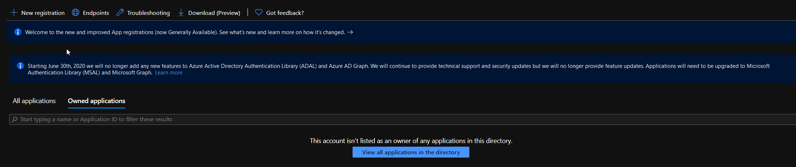</a>
</figure>

Click on the **New Registration** and fill the various fields accordingly, unless you have specific needs all default values should suffice for most configurations/deployments. I am assuming a single tenant deployment in the following example

<figure>
  <a href="{{ '/assets/images/exchange-online-certificate-authentication/ExoV2_Registration.png' | relative_url }}">
  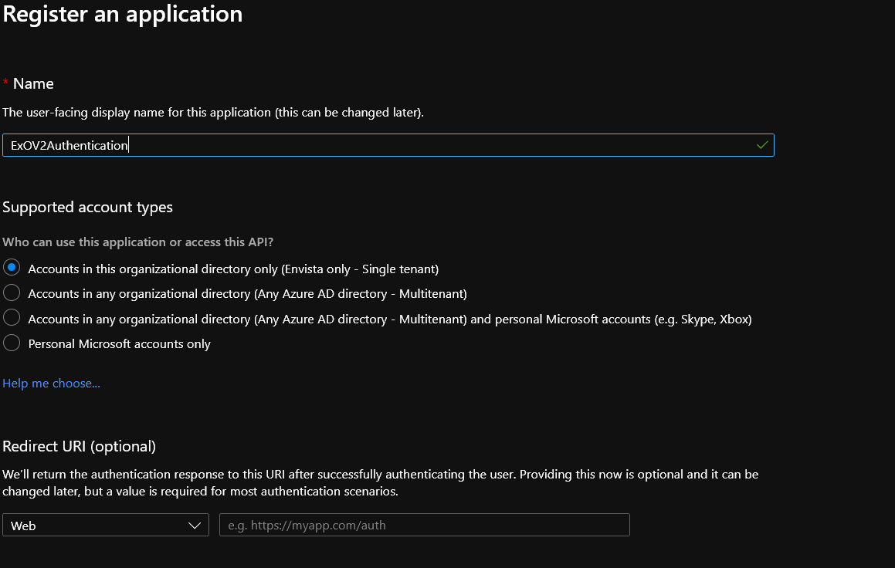</a>
</figure>

Once done click on the **Register** button, provision will only take a couple of seconds.

<figure>
  <a href="{{ '/assets/images/exchange-online-certificate-authentication/Azure_Application_Registration_Summary.png' | relative_url }}">
  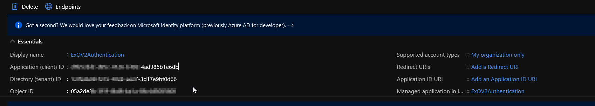</a>
</figure>

**Note:** The only field really needed in the *Name* one just be sure to choose a descriptive name that is easy for you to remember.
{: .notice--danger}

### Exchange Online Certificate Based authentication - Grant API Permissions

Once the application has been registered we need to configure/grant API permissions that will define what our application can and cannot do. Either select *API Permissions* from the left blade or from the link directly below the API properties and select **Add permission**

<figure>
  <a href="{{ '/assets/images/exchange-online-certificate-authentication/Configure_API_Permissions.png' | relative_url }}">
  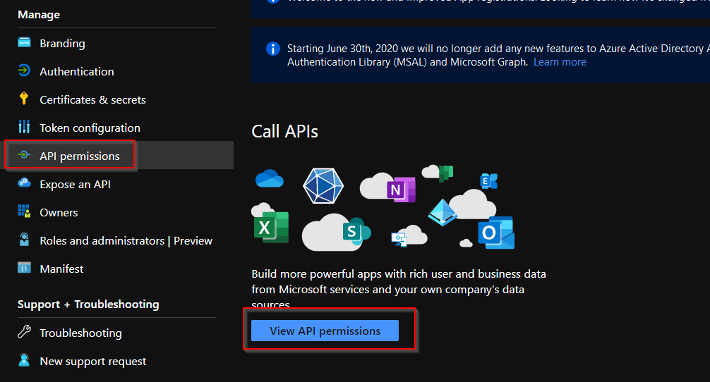</a>
</figure>

From the **Request API Permissions** scroll all the way down the *Supported Legacy APIs* and select **Exchange**, **Application Permissions** and finally tick **Exchange.ManageAsApp** under the *Exchange* section

**Historical UI note:** The screenshot uses the portal labels from 2020. Use the current Microsoft procedure to locate the Exchange application permission; the old label is not a statement about Microsoft Graph capabilities.
{: .notice--primary}

<figure class="half">
	<a href="{{ '/assets/images/exchange-online-certificate-authentication/Exchange_API_Permissions.png' | relative_url }}">
  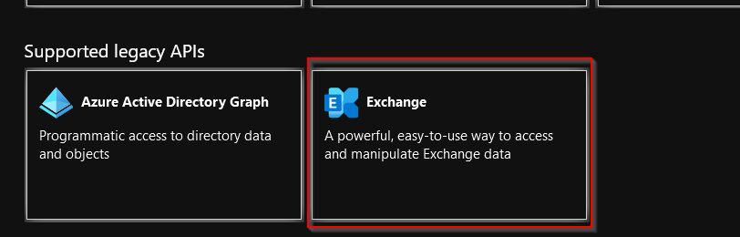</a>
	<a href="{{ '/assets/images/exchange-online-certificate-authentication/Exchange_API_Permissions._2.png' | relative_url }}">
  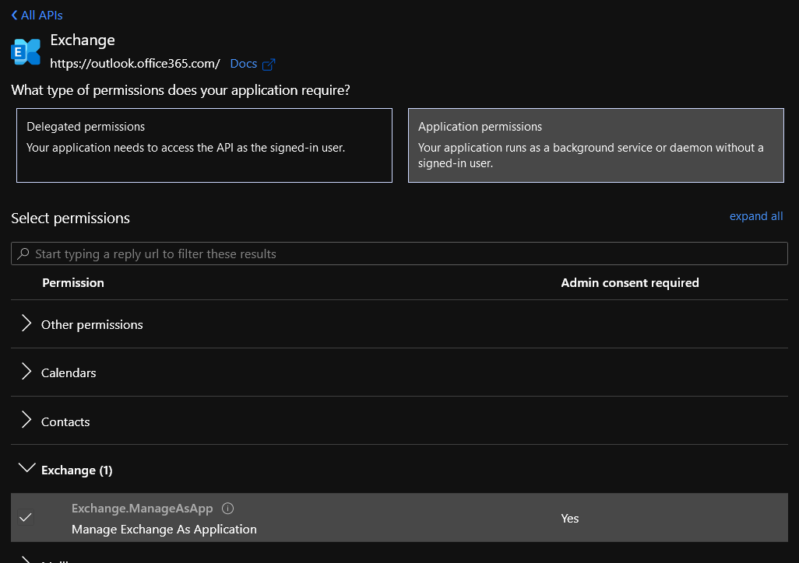</a>
</figure>

The last step involves clicking the **Grant Admin Consent for <your tenant name>** to consent to the requested application permission. Management authorisation must also be configured through the appropriate roles.

<figure>
  <a href="{{ '/assets/images/exchange-online-certificate-authentication/EXO_Grant_Admin_Consent.png' | relative_url }}">
  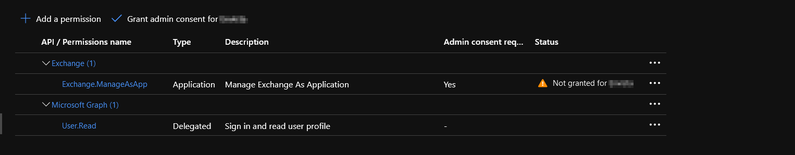</a>
</figure>

## Exchange Online Certificate Based authentication - Configure Authentication

For this certificate-based flow, the application uses its certificate and private key to obtain an access token. Tokens are part of the authentication process; the original claim that token authentication is inherently less secure was incorrect.

Self-signed certificates can be used, but possession of the private key permits authentication as the application. Protect private-key access, rotate certificates and do not commit private keys or their passwords to a repository.

You can easily create a self-signed certificate via PowerShell with the following command:

```powershell
$paramNewSelfSignedCertificate = @{
    Subject           = 'Exchange Online Background Process'
    CertStoreLocation = 'cert:\CurrentUser\My'
    KeySpec           = 'KeyExchange'
    FriendlyName      = 'Exchange Online Authentication Certificate'
    KeyAlgorithm      = 'RSA'
    KeyLength         = 2048
    Provider          = 'Microsoft Enhanced RSA and AES Cryptographic Provider'
    NotAfter          = (Get-Date).AddYears(1)
}

$certificate = New-SelfSignedCertificate @paramNewSelfSignedCertificate
$certificate | Select-Object Thumbprint, Subject, NotAfter
```

**Note:** This Windows example explicitly requests an RSA key with a CSP provider and a one-year validity period. The certificate is created in the current user’s Personal store. Run the job under an identity that can access the required private key; creating a certificate in your own store does not deploy it to a service account.
{: .notice--primary}

Open *Certificate Manager* MMC console and under *Certificates Current User / Personal / Certificates* right-click on the certificate and select *All Tasks / Export*. Just follow the export wizard be sure to select *Do not export private key* and select **CER** as the export format.

In the Azure Portal select *Certificates and Secretes* from the left blade and *Upload certificate* navigating to the path where the certificate has been exported/stored

<figure>
  <a href="{{ '/assets/images/exchange-online-certificate-authentication/Azure_Certificate_Upload.png' | relative_url }}">
  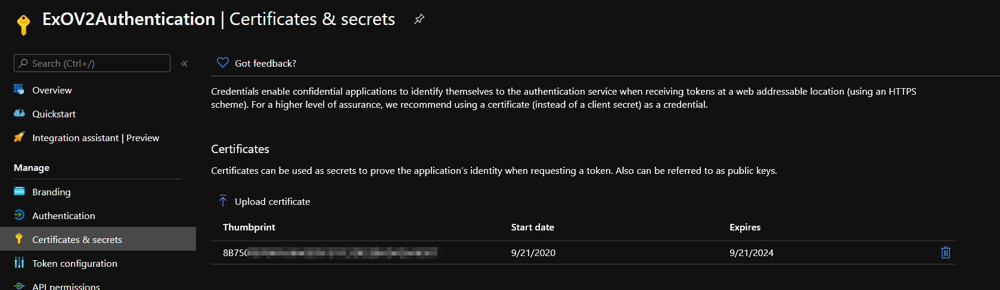</a>
</figure>

**Note:** Write down the certificate thumbprint displayed in the Azure page as we will need this later on.
{: .notice--primary}

## Exchange Online Certificate Based authentication - Grant permissions

The following screenshots show the original broad Microsoft Entra directory-role assignment. Current Exchange Online app-only guidance also supports custom role groups assigned through service principals. Use those options when the task needs fewer commands or a restricted recipient write scope; review the complete permission set because grants from different sources combine.

Do not assign a permanent Exchange Administrator role simply to reproduce these screenshots. Choose the authorisation model in the [current app-only procedure](https://learn.microsoft.com/en-us/powershell/exchange/app-only-auth-powershell-v2).

In the original 2020 workflow, the *Azure AD* **Roles and administrators** page was used to assign **Exchange Administrator**. The screenshot below records that broad historical assignment; it is not an instruction to grant it to a new automation.

<figure>
  <a href="{{ '/assets/images/exchange-online-certificate-authentication/Azure_Exchange_Admin_Role.png' | relative_url }}">
  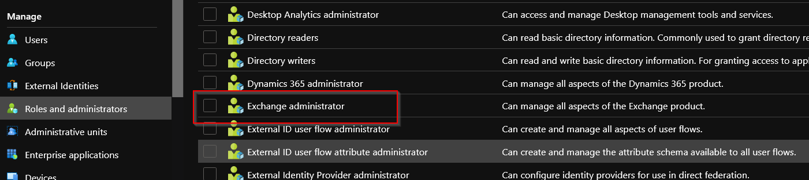</a>
</figure>

The historical *Select Member* dialog identified the application by its GUID.

<figure>
  <a href="{{ '/assets/images/exchange-online-certificate-authentication/Azure_Exchange_Assignment.png' | relative_url }}">
  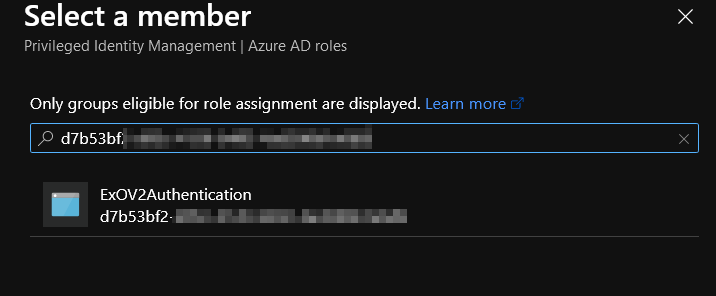</a>
</figure>

The original *Add Assignment* screen showed an **Active**, permanent assignment. For a current deployment, choose the required Exchange authorisation model and scope rather than reproducing that selection.

<figure>
  <a href="{{ '/assets/images/exchange-online-certificate-authentication/Add_Assignment_Page.png' | relative_url }}">
  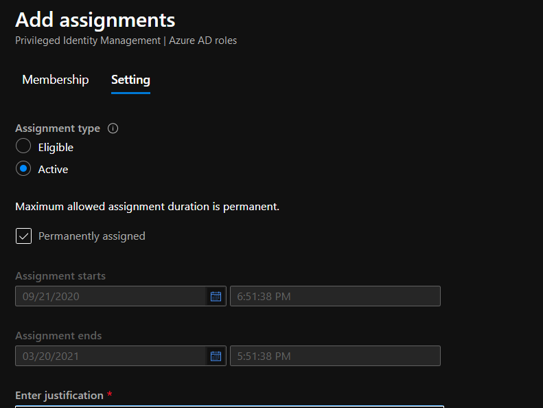</a>
</figure>

Once configuration is complete you will see a page similar the following

<figure>
  <a href="{{ '/assets/images/exchange-online-certificate-authentication/Azure_Assignment_Confirmation.png' | relative_url }}">
  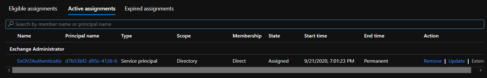</a>
</figure>

Where you can review applied configuration and make any required change.

## Exchange Online Certificate Based authentication - Testing connection

After configuring the application using current guidance, this connection pattern uses a certificate in the Windows certificate store. Define the three variables below with your own configuration first. The historical module version 2.0.3 is not a deployment prerequisite today.

```powershell
$paramConnectExchangeOnline = @{
    CertificateThumbprint = $certThumbPrint
    AppId                 = $appId
    Organization          = $exchangeOrgId
}

Connect-ExchangeOnline @paramConnectExchangeOnline
```

Where *certThumbPrint* is the certificate thumbprint we created and uploaded to Azure, *appId* is the ID of the application we created and *exchangeOrgId* is the name of the tenant in the form **tenantName.onmicrosoft.com**

And here's the result

<figure>
  <a href="{{ '/assets/images/exchange-online-certificate-authentication/Exchange_Get_Mailbox.png' | relative_url }}">
  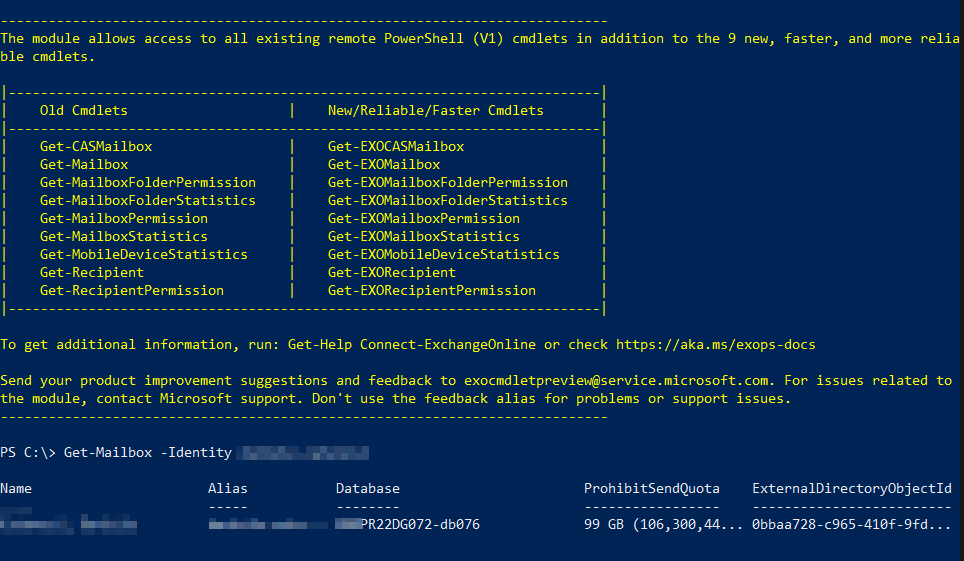</a>
</figure>

## Closing notes

This was quite a long post but steps to get up and running with Exchange Online Certificate based authentication are numerous even if not difficult to implement but well worth following.

Certificate Based authentication resolves a number of challenges administrators had to face up to this point, chief among all [storing credentials](https://singularvector.github.io/powershell/howto/Store-Credentials-in-PowerShell-Script/) without storing a user password in the script. The certificate’s private key is itself a credential and must be protected.
