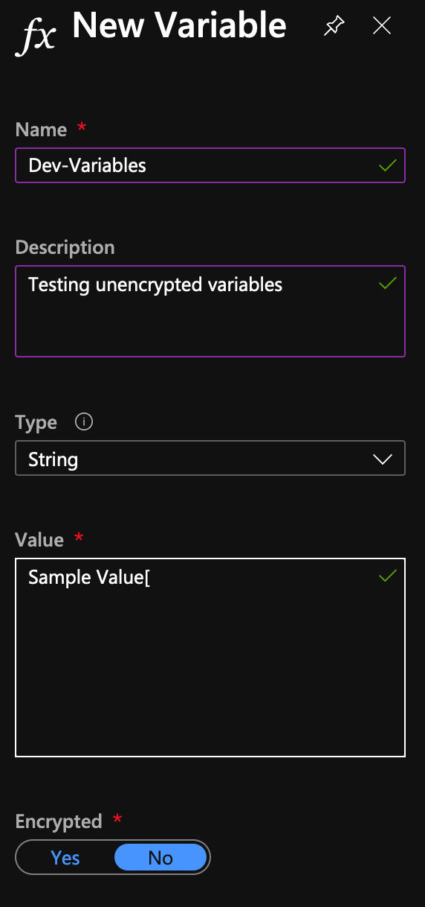
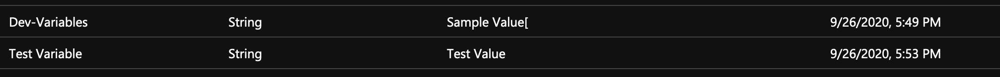
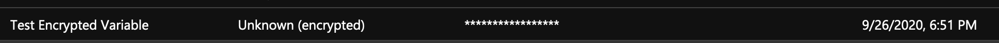
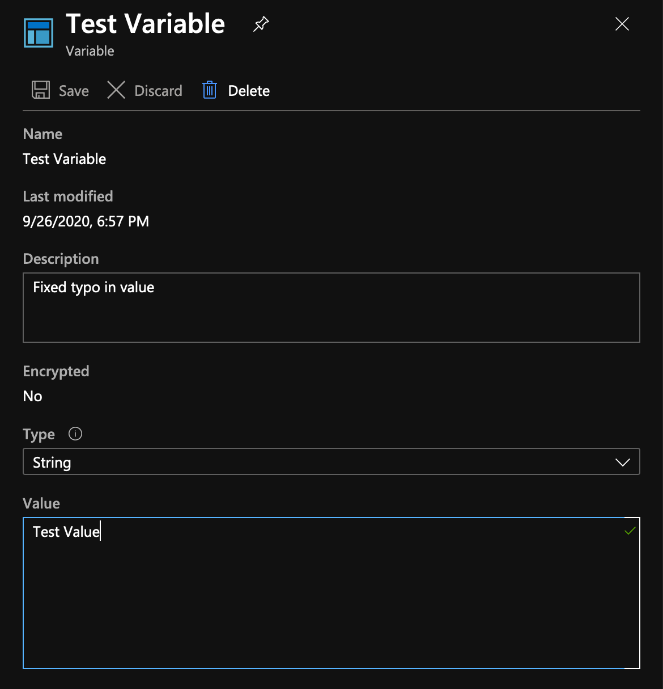
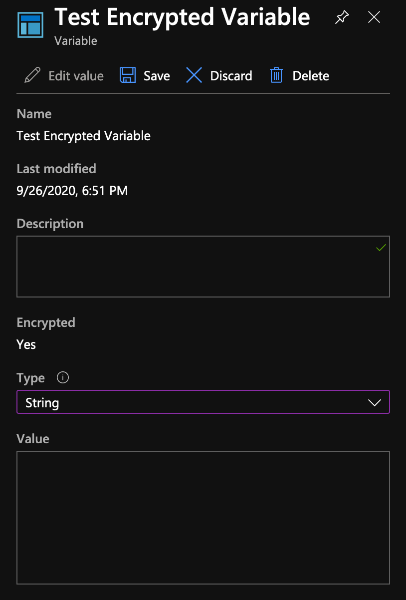

## Azure Automation Variables as Shared Resources

Azure Automation shared resources include credentials, modules, schedules, connections, certificates and **variables**. This post focuses on variables.

The original example came from a runbook pulling data from a web service. It needed an API secret to obtain an authentication token, and that value had to be available without being embedded in the runbook source.

For unattended jobs, first consider an identity-based flow that avoids an API secret. If the service requires a secret, keep it outside source code and retrieve it only in the execution context that needs it. See [credential storage options]().

An encrypted Automation variable can centralise a value used by runbooks. It protects the stored asset, but a runbook authorised to read it receives the usable value at runtime. Access to editing or running runbooks therefore matters as much as the variable's encryption flag.

The portal screenshots below are from the original 2020 walkthrough; consult the [current Azure Automation variables documentation](https://learn.microsoft.com/en-us/azure/automation/shared-resources/variables) for runtime and interface differences.

## Azure Automation Variables Types

Variables can be stored as *encrypted* or *unencrypted* assets. The portal offers these value types:

- Integers
- Strings
- DateTime
- Boolean
- Null

The current documentation is available [here](https://docs.microsoft.com/en-us/azure/automation/shared-resources/variables).

### Unencrypted variables

An *unencrypted* variable has a value visible to callers with the relevant management permissions, as well as to runbooks.

An unencrypted variable can be created in the Azure portal going to **[Automation Account] / [Shared Resources] / [Variables]** and selecting **Add Variable** being sure to select *No* under the **Encrypted** section.

<figure>
  <a href="{{ '/assets/images/azure-automation-variables/Azure_Automation_Unencrypted_Variable.png' | relative_url }}">
  </a>
</figure>

**Note:** Typo in the above variable value is intended.
{: .notice--primary}

The same operation can be achieved via PowerShell assuming the **Az** module is installed on the system:

```powershell
$paramNewAzAutomationVariable = @{
    ResourceGroupName     = $azResourceGroup
    AutomationAccountName = $azAccount
    Name                  = 'Test Variable'
    Encrypted             = $false
    Value                 = 'Test Value'
}

New-AzAutomationVariable @paramNewAzAutomationVariable

# Output
Value                 : Test Value
Encrypted             : False
ResourceGroupName     : Dev-PsCustomObject-AutomationRsg
AutomationAccountName : Dev-PsCustomObject
Name                  : Test Variable
CreationTime          : 26.09.2020 17:53:23 +02:00
LastModifiedTime      : 26.09.2020 17:53:23 +02:00
Description           :
```

Once created, the variable appears in the portal:

<figure>
  <a href="{{ '/assets/images/azure-automation-variables/Azure-Automatin-Unencrypted-Variables-Console.png' | relative_url }}">
  </a>
</figure>

The value appears both in the PowerShell output and in the portal’s *Value* column.

### Encrypted variables

To create an *encrypted* variable, select encryption in the portal or specify `-Encrypted $true` in PowerShell.

```powershell
$paramNewAzAutomationVariable = @{
    ResourceGroupName     = $azResourceGroup
    AutomationAccountName = $azAccount
    Name                  = 'Test Encrypted Variable'
    Encrypted             = $true
    Value                 = 'Test Value'
}

New-AzAutomationVariable @paramNewAzAutomationVariable

# Output
Value                 :
Encrypted             : True
ResourceGroupName     : Dev-PsCustomObject-AutomationRsg
AutomationAccountName : Dev-PsCustomObject
Name                  : Test Encrypted Variable
CreationTime          : 26.09.2020 18:51:53 +02:00
LastModifiedTime      : 26.09.2020 18:51:53 +02:00
Description           :
```

For an encrypted asset, the creation output omits the value. The original portal view looked like this:

<figure>
  <a href="{{ '/assets/images/azure-automation-variables/Azure_Automation_Encrypted_Variable.png' | relative_url }}">
  </a>
</figure>

Azure Automation encrypts these assets at rest using an account-specific key. Management views hide the stored value, while authorised runbooks can retrieve it at runtime; encryption does not stop runbook code from exposing the value.

### Update and Retrieve Azure Automation variable values

Now that we know how to create azure automation variables let’s see how to work with them and update their values. Recall I had a typo in the unencrypted variable, trailing '[' character, let's fix that from the console

<figure>
  <a href="{{ '/assets/images/azure-automation-variables/Azure_Automation_Update_Variable_Value.png' | relative_url }}">
  </a>
</figure>

Or from PowerShell

```powershell
$paramSetAzAutomationVariable = @{
    ResourceGroupName     = $azResourceGroup
    AutomationAccountName = $azAccount
    Name                  = 'Test Variable'
    Value                 = 'Setting new value from PowerShell'
    Encrypted             = $False
}

Set-AzAutomationVariable @paramSetAzAutomationVariable

Value                 : Setting new value from PowerShell
Encrypted             : False
ResourceGroupName     : Dev-PsCustomObject-AutomationRsg
AutomationAccountName : Dev-PsCustomObject
Name                  : Test Variable
CreationTime          : 26.09.2020 17:53:23 +02:00
LastModifiedTime      : 26.09.2020 19:08:28 +02:00
Description           : Fixed typo in value
```

For an encrypted variable, the portal hides the existing value. Select *Edit value* to replace it, then save the change. Authorised runbooks can still retrieve the resulting value at runtime.

<figure>
  <a href="{{ '/assets/images/azure-automation-variables/Azure_Automation_Update_Encrypted_Variable.png' | relative_url }}">
  </a>
</figure>

The equivalent PowerShell update also omits the value from its response:

```powershell
$paramSetAzAutomationVariable = @{
    ResourceGroupName     = $azResourceGroup
    AutomationAccountName = $azAccount
    Name                  = 'Test Encrypted Variable'
    Value                 = 'Setting new value from PowerShell'
    Encrypted             = $true
}

Set-AzAutomationVariable @paramSetAzAutomationVariable

Value                 :
Encrypted             : True
ResourceGroupName     : Dev-PsCustomObject-AutomationRsg
AutomationAccountName : Dev-PsCustomObject
Name                  : Test Encrypted Variable
CreationTime          : 26.09.2020 18:51:53 +02:00
LastModifiedTime      : 26.09.2020 19:14:46 +02:00
Description
```

## Getting Variable Values

Up to this point we've seen how to create and update Azure Automation variables, let's explore how to get values for configured variables.
*Az* module makes available a cmdlet for the purpose

```powershell
Get-AzAutomationVariable -ResourceGroupName $azureResourceGroup -AutomationAccountName $azureAccount -Name 'Test Variable'

Value                 : Setting new value from PowerShell
Encrypted             : False
ResourceGroupName     : Dev-PsCustomObject-AutomationRsg
AutomationAccountName : Dev-PsCustomObject
Name                  : Test Variable
CreationTime          : 26/09/2020 17:53:23 +02:00
LastModifiedTime      : 26/09/2020 19:08:28 +02:00
Description           : Fixed typo in value
```

**Note:** Omitting the *-Name* parameter will return all configured variables
{: .notice--primary}

Inside an Automation runbook, use **Get-AutomationVariable** to retrieve an encrypted asset. This is a runtime command, not a local replacement for the Az management cmdlets. Check that it is available in the runtime or Hybrid Worker environment you target.

```powershell
$encryptedVariableValue = Get-AutomationVariable -Name 'Test Encrypted Variable'

if ([string]::IsNullOrEmpty([string]$encryptedVariableValue)) {
    throw 'The required encrypted variable has no value.'
}
# Pass the value directly to the API client; do not print it.
```

Do not write secret values to the output stream, verbose logs or the Automation test pane. The original demonstration did that with a sample value; production runbooks should not copy that pattern.

A variable's encryption status cannot be changed in place after creation; changing it requires re-creating the asset. Coordinate that change with dependent runbooks. Plan secret rotation separately from code deployment, and restrict access to the Automation account and runbook output.
