## Scope of this historical walkthrough

This is the original **2021 NuGet.Server / ASP.NET Framework / IIS** deployment, with its screenshots retained for reference. It is not a current production deployment checklist. The useful part is the distribution model: a central internal feed lets a team publish versioned modules and install them consistently.

Before deploying a feed now, check the hosting platform's support status and the repository protocols required by your clients. `Install-Module`/PowerShellGet and `Install-PSResource`/PSResourceGet do not share every repository capability or configuration. Microsoft's [private PowerShell Gallery guidance](https://learn.microsoft.com/en-us/powershell/gallery/how-to/working-with-local-psrepositories) explains client-side registration and usage; the [NuGet.Server guide](https://learn.microsoft.com/en-us/nuget/hosting-packages/nuget-server) covers this specific server approach.

A production deployment also needs HTTPS, restricted publishing credentials, read-access controls where required, package backup/retention and a defined update process. The localhost HTTP check below is only a local smoke test, not the URL clients should use to send a publishing key.

## PowerShell repositories

If you follow my blog you probably know my [GitHub](https://github.com/SingularVector) where I share modules like the [IT-ToolBox](https://github.com/SingularVector/IT-ToolBox) or handy standalone [Functions](https://github.com/SingularVector/PowerShell-Functions) that I developed to solve specific issues.

In my posts I often talked about [PowerShell Gallery](https://singularvector.github.io/powershell/tips/PowerShell-Restore-Default-Repository/) which you probably already used to install a module released by Microsoft or other developers.

Both are great tools when sharing code with a large audience over the internet, GitHub private repositories are outside the scope of this article, but a large chunk of my work involves developing _modules_ that my colleagues and I use internally for automation purposes. These modules usually leverage technologies that are available only in my work environment and sometimes implement functions that would not have much sense outside my company.

One of the main issues we faced when initially started development of our own modules is ease of distribution to other team members for this reason we've setup internal **NuGet** repositories which can be used an _internal_ PowerShell Gallery.

## Required tools

Here's what you will need to follow this article and setup your own PowerShell repository:

- A copy of **[Visual Studio](https://visualstudio.microsoft.com/downloads/)** choose an edition whose licence permits your use
- The ASP.NET and web development workload installed [here's](https://docs.microsoft.com/en-us/visualstudio/install/modify-visual-studio?view=vs-2019) a guide on how to modify an existing Visual Studio installation in case you don't have the appropriate workload installed already
- A server with a supported Windows Server, IIS and .NET Framework combination for the NuGet.Server version you deploy; the original lab used Windows Server 2019

**Note:** If you do not have or cannot install Visual Studio at the end of the post I have posted a link to my [GitHub Repository](https://github.com/SingularVector/Nuget-PowerShell-Repository/tree/main/NuGetRepository/NuGetRepository)

## Create the Visual Studio Project

Once all requirements are in place open Visual Studio and create a project using the _ASP.Web Application (Visual C#)_ template.

<figure>
  <a href="{{ '/assets/images/internal-powershell-repository/VS_Create_New_Project.png' | relative_url }}">
  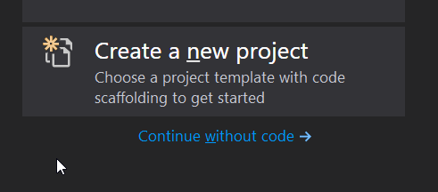</a>
</figure>

<figure>
  <a href="{{ '/assets/images/internal-powershell-repository/VS_Web_Application.png' | relative_url }}">
  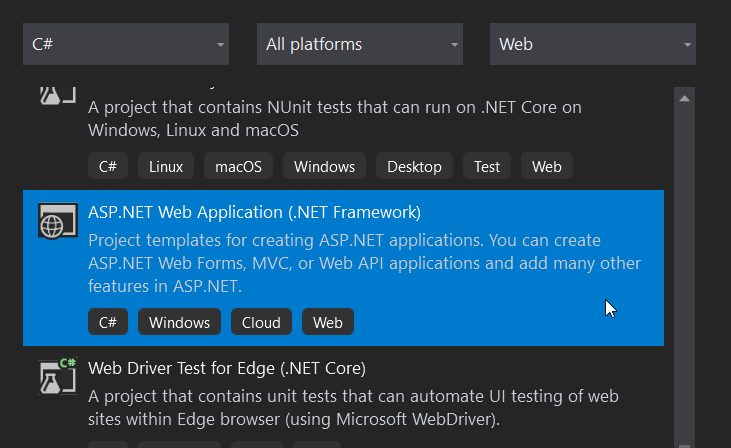</a>
</figure>

Application name is not important just avoid _NuGet_ as this would create a conflict with one of the _packages_ we need to install as part of the dependencies, in my example I've used **NuGetRepository** but it can really be anything

<figure>
  <a href="{{ '/assets/images/internal-powershell-repository/Application_Configuration.png' | relative_url }}">
  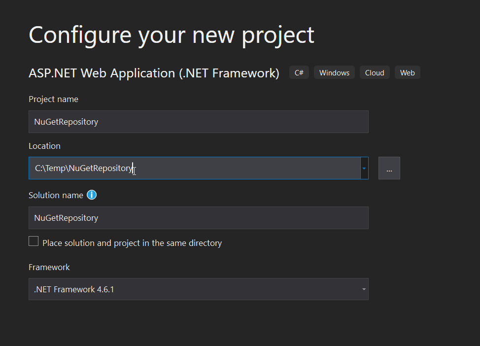</a>
</figure>

In the screen that will appear simply select the _Empty_ template and then the _Create_ button

<figure>
  <a href="{{ '/assets/images/internal-powershell-repository/Project_Configuration.png' | relative_url }}">
  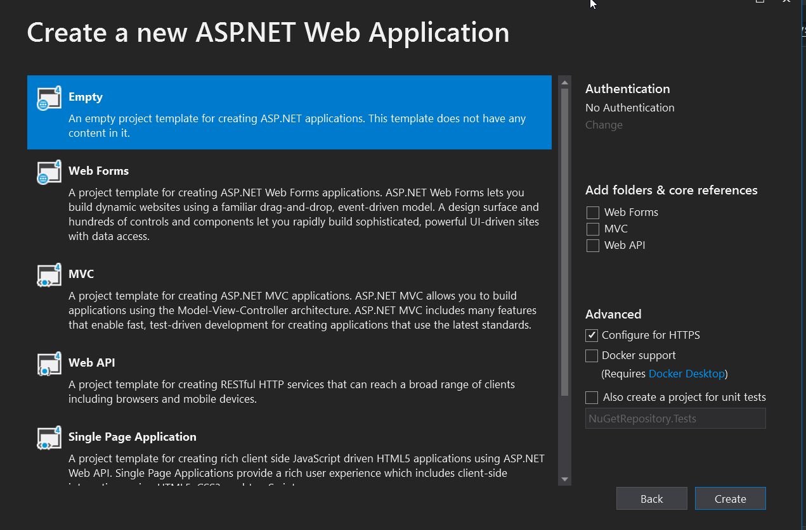</a>
</figure>

Once project has finished loading/being created _right-click_ on the project name in _solution explorer_ and select **Manage NuGet Packages**

<figure>
  <a href="{{ '/assets/images/internal-powershell-repository/Manage_NuGet_Package.png' | relative_url }}">
  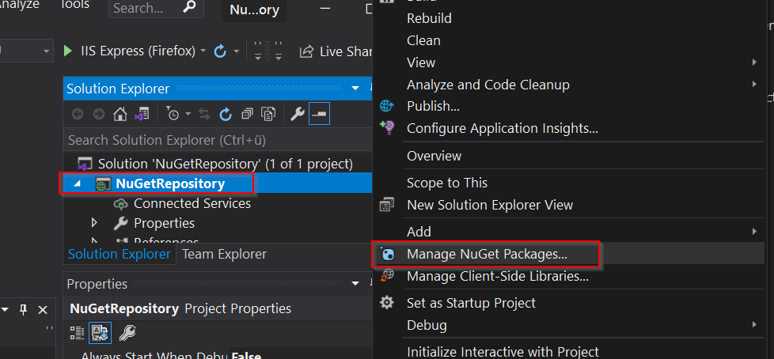</a>
</figure>

In the _NuGetRepository_ window select the _Browse_ tab and search for package **NuGet.Server** and click on the **Install** button.

<figure>
  <a href="{{ '/assets/images/internal-powershell-repository/Install_NuGet_Component.png' | relative_url }}">
  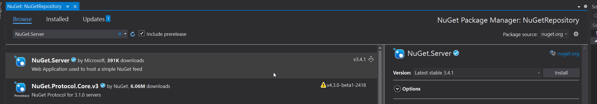</a>
</figure>

Keep I am using the latest stable release available at the time of this writing but you can select a different version of the package suiting your needs.

This step will take some time, depending on your connection speed, and a window showing you changes to the solution and asking your confirmation will appear in which case simply click on the _Ok_ button.

Once the installation step is complete I highly recommend to change the build type from _Debug_, default for new projects, to _Release_ then check the deployed configuration separately: Release build selection alone does not establish that ASP.NET debug settings are disabled.

<figure>
  <a href="{{ '/assets/images/internal-powershell-repository/Set_Build_Type.png' | relative_url }}">
  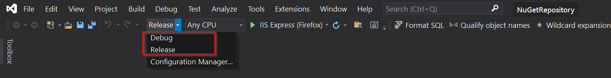</a>
</figure>

Once this is done go to _Build / Build Solution_ menu, or press F6 if you're lazy like me, to _package_ together all files making up the solution.

This will create a folder structure, under the path previously specified, containing all files required by the solution. Project path is visible in the **Properties** window under the _Project Folder_ field

<figure>
  <a href="{{ '/assets/images/internal-powershell-repository/Project_Path.png' | relative_url }}">
  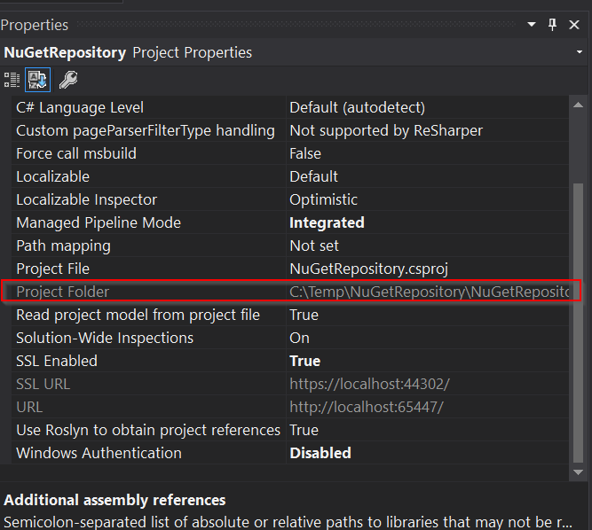</a>
</figure>

**Note:** By default solution will be build under the C:\Users\username\source\repos\AppName\AppName\ path

## Install required Server Components

Once the solution has been build in Visual Studio move on the server that will be hosting the repository and launch the following cmdlet from an elevated PowerShell session to install required _IIS_ components

```powershell
# Splatted version
$paramInstallWindowsFeature = @{
    Name = 'Web-Server', 'Web-Net-Ext45', 'Web-Asp-Net45', 'Web-ISAPI-Filter', 'Web-ISAPI-Ext'
    IncludeManagementTools = $true
}

Install-WindowsFeature @paramInstallWindowsFeature

# Long unsplatted version
Install-WindowsFeature Web-Server,Web-Net-Ext45,Web-Asp-Net45,Web-ISAPI-Filter,Web-ISAPI-Ext -IncludeManagementTools
```

Once all components are in place copy the solution files to a directory on the server with the default being _C:\inetpub\wwwroot_. Path is not really import and could be anything you'd like, I will just stick with the default.

As a reference here's how the content of my application folder looks like on my test server

<figure>
  <a href="{{ '/assets/images/internal-powershell-repository/IIS_Application.png' | relative_url }}">
  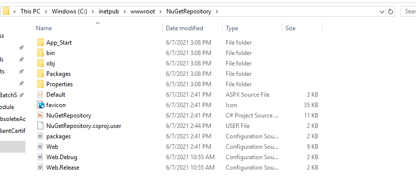</a>
</figure>

### Update Web.Config configuration file

The **web.config** file is located in the project root folder, assuming default path this will be _C:\inetpub\wwwroot\NuGetRepository_, open it with a text editor and under the **\<system.web\>** section you should see line similar the following (actual .Net Framework version could vary)

```xml
  <system.web>
    <compilation debug="true" targetFramework="4.6.1" />
    <!-- maxRequestLength is specified in Kb -->
    <httpRuntime targetFramework="4.6.1" maxRequestLength="30720" />
    <compilation debug="true" targetFramework="4.6" />
  </system.web>
```

Comment out or delete one of the instances of **\<compilation\>** tag so that resultant file will be similar the following

```xml
  <system.web>
    <compilation debug="false" targetFramework="4.6.1" />
    <!-- maxRequestLength is specified in Kb -->
    <httpRuntime targetFramework="4.6.1" maxRequestLength="30720" />
  </system.web>
```

**Note:** If the _web.config_ file is not updated when opening the IIS Application an _Internal Server Error_ message will be displayed an application won't work.

The framework versions shown are historical. Target a supported framework for the server and application you actually deploy, and confirm that the final published `web.config` has debugging disabled.

## Deploy Application to IIS

We can finally deploy the _NuGet_ application to IIS to do so open **IIS Manager / Expand <Server Name> / Sites** right-click on Default Web Site and select **Add Application**

<figure>
  <a href="{{ '/assets/images/internal-powershell-repository/Add_Application.png' | relative_url }}">
  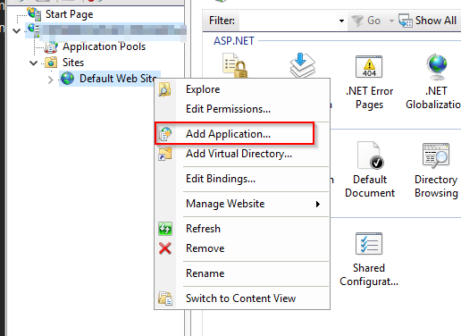</a>
</figure>

In the window that appears provide a name (alias) for the application and specify the path where application files reside

<figure>
  <a href="{{ '/assets/images/internal-powershell-repository/Application_Alias.png' | relative_url }}">
  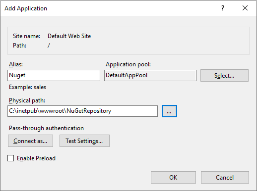</a>
</figure>

To test the configuration point your browser to **http://localhost/Nuget** which should yield the following page

<figure>
  <a href="{{ '/assets/images/internal-powershell-repository/Nuget_Page.png' | relative_url }}">
  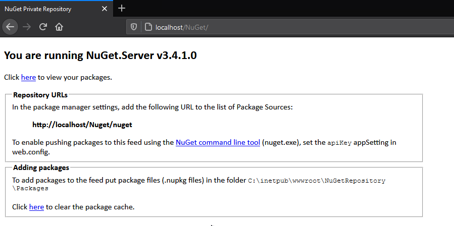</a>
</figure>

### Configure Package Directory

In the default configuration packages are stored under the same path where the application lives in the _Packages_ directory, in our example _C:\inetpub\wwwroot\Nuget\Packages_. This can be changed in the _web.config_ configuration file via the following tag

```xml
    <!--
    Change the path to the packages folder. Default is ~/Packages.
    This can be a virtual or physical path.
    -->
    <add key="packagesPath" value="C:\SomePath\Packages" />
```

### Configure Repository API Key

Up to this point the repository is ready and can be used to _download_ packages from it but if we need to _upload_ data, in our example PowerShell modules, to it we would need some form of authentication which in NuGet is accomplished through an API key.

First of all generate a unique API key, I generally use a GUID generated via _New-Guid_ cmdlet, open the _web.config_ file and update the **apiKey** value as in the following example

```xml
    <!--
    Determines if an Api Key is required to push\delete packages from the server.
    -->
    <add key="requireApiKey" value="true" />
    <!--
    Set the value here to allow people to push/delete packages from the server.
    NOTE: This is a shared key (password) for all users.
    -->
    <add key="apiKey" value="REPLACE_WITH_PRIVATE_API_KEY" />
```

Keep `requireApiKey` enabled for publishing. This shared key controls push/delete operations; it is not per-user authorisation and does not by itself restrict who can download packages. Protect the deployed configuration file and transmit publishing credentials only over HTTPS.

## Closing notes

This guide should set you in the right path for configuring your own internal PowerShell module repository but this is just the tip of the iceberg.

In the next articles I will explain how to register a repository and push modules to it.

## GitHub Link

I have created a GitHub repository where I've posted both the package and the full Visual Studio Solution so you can simply download the files and be up and running in no time.

- [This is the direct link to the application files](https://github.com/SingularVector/Nuget-PowerShell-Repository/tree/main/NuGetRepository/NuGetRepository) that you can simply copy over to IIS
- [This is the link to the base repository](https://github.com/SingularVector/Nuget-PowerShell-Repository) containing readme, changelog etc.

The linked repository is the original example. Check its dependencies and maintenance status before adopting it; this article does not claim that the historical project is continuously updated.
